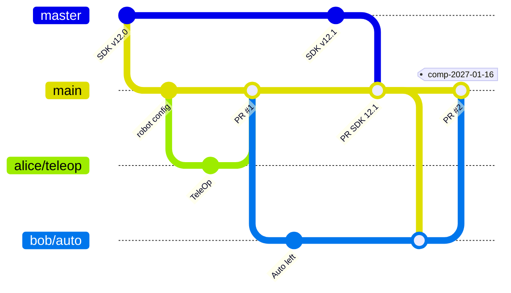

# FTC code configuration management

**Who:** the whole team. Read once, apply at every session.
**Prerequisites:** repository set up as in [Set up GitHub](github-equipe.md).

These rules keep the robot from breaking the night before a match, and let you always find the exact code that ran at a competition.

## Three kinds of branches

| Branch | Role | Who changes it |
|---|---|---|
| `master` | **Mirror of the *FIRST* SDK.** Exact copy of the official repository, never edited by hand. | Nobody directly. Updated with `Sync fork` (administrators). |
| `main` | **Team reference.** Always builds. The only version that goes on the robot for a match. Default branch of the repository. | Only through pull requests. |
| `firstname/topic` | **One branch per task**: `firstname/teleop-mecanum`, `firstname/auto-left`… Starts from `main`, comes back into `main` through a pull request, then gets deleted. | Its author. |

Why not work directly on `master`? Because keeping `master` identical to *FIRST*'s repository makes SDK updates trivial (no conflict can happen on `master`), and confines any conflicts to a reviewable pull request into `main`.

## Overview

How to read it: `master` only receives SDK releases. `main` takes in work from branches through pull requests, and the new SDK through a `master` → `main` pull request. Branches in progress catch up from `main`. On competition day, a tag is added.

## A student's workflow

1. Update `main`, then create your `firstname/topic` branch from `main`.
2. Commit often, in small steps, with messages that say what changes ("Add arm control", not "changes").
3. Before opening the pull request: `BUILD SUCCESSFUL`, and if possible a test on the robot.
4. Pull request into `main`, with one sentence on what changes and how it was tested. Someone else reviews and approves.
5. After the merge, delete your branch and start again from `main` for the next task.

Your branch has fallen behind `main`? In Android Studio, on your branch: `Git` → `Merge…` → `origin/main`.

!!! tip "Keep branches short"
    A branch that lives more than a week or two piles up conflicts. Split big topics into several pull requests.

## Integrating a new SDK release

*Repository administrators only.*

1. Read the release notes, especially the *Breaking Changes* section of the new version's `README`.
2. On the repository page, `master` branch: `Sync fork` → `Update branch`. No conflict is possible, since nobody touches `master`.
3. Open a pull request `master` → `main`, titled "SDK vX.Y". **Careful:** in a fork, GitHub defaults the target (`base repository`) to *FIRST*'s repository. Pick your own repository on both sides: `base: my-ftc-team/…` · `main` ← `head: my-ftc-team/…` · `master`.
4. Any conflicts are almost always in `TeamCode`'s Gradle files (libraries added by the team). Resolve them in a dedicated branch if needed.
5. Check out the pull request branch, build, test on the robot, then merge.
6. Tell the team: everyone updates their branch from `main`.

!!! warning "No new SDK right before a competition"
    Avoid changing SDK versions in the two weeks before an event.

!!! note "Update the Control Hub too"
    A new SDK often comes with a new Driver Station app version, and sometimes new Control Hub firmware. Check the release notes.

## Competition versions

1. Before each event, freeze `main`: only fixes get merged.
2. On the day, tag `main`: `Releases` → `Draft a new release` → tag `comp-YYYY-MM-DD` (for example `comp-2027-01-16`), target `main`.
3. Emergency fix during the event: short branch, test, merge, new tag (`comp-2027-01-16-b`).

That way you can always find the exact code that ran in a match, and compare two competitions.

## New season

GitHub allows **only one fork of a given repository per organization**. So you do not create a new repository each season: **the repository holds one season at a time**, and past seasons stay reachable through their tags.

1. Tag the end of the season on `main`: `end-season-2026-27`.
2. When *FIRST* releases the new season's SDK: `Sync fork` on `master`, then a `master` → `main` pull request as above.
3. Code for the old game that is no longer needed is moved or deleted in a "Season cleanup" pull request. It stays available through the tag.

!!! tip "Reusing code across seasons"
    Generic code (mecanum drive, odometry, utilities) deserves its own package inside `TeamCode`, so it survives the season cleanup.
