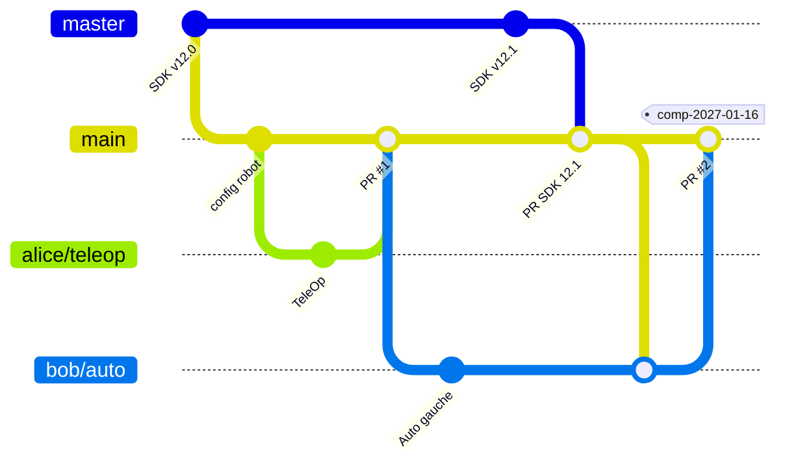

# Gestion de configuration du code FTC

**Pour qui :** toute l'équipe. À lire une fois, à appliquer à chaque séance.
**Prérequis :** dépôt mis en place comme dans [Mettre en place GitHub](github-equipe.md).

Ces règles évitent de casser le robot la veille d'un match, et permettent de toujours retrouver le code exact qui a tourné en compétition.

## Les trois sortes de branches

| Branche | Rôle | Qui la modifie |
|---|---|---|
| `master` | **Miroir du SDK de *FIRST*.** Copie exacte du dépôt officiel, jamais modifiée à la main. | Personne directement. Mise à jour par `Sync fork` (administrateurs). |
| `main` | **Référence de l'équipe.** Toujours compilable. C'est la seule version qui va sur le robot en match. Branche par défaut du dépôt. | Uniquement par pull request. |
| `prenom/sujet` | **Une branche par tâche** : `prenom/teleop-mecanum`, `prenom/auto-gauche`… Part de `main`, revient dans `main` par pull request, puis est supprimée. | Son auteur. |

Pourquoi ne pas travailler directement sur `master` ? Parce que garder `master` identique au dépôt de *FIRST* rend les mises à jour du SDK triviales (aucun conflit possible sur `master`), et isole les éventuels conflits dans une pull request relisible vers `main`.

## Vue d'ensemble

Lecture : `master` ne reçoit que les versions du SDK. `main` intègre le travail des branches par pull request, et le nouveau SDK par une pull request `master` → `main`. Les branches en cours se remettent à jour depuis `main`. Le jour de la compétition, on pose un tag.

## Le cycle de travail d'un élève

1. Mettez `main` à jour, puis créez votre branche `prenom/sujet` à partir de `main`.
2. Commitez souvent, par petites étapes, avec des messages qui disent ce qui change (« Ajout du contrôle du bras », pas « modif »).
3. Avant d'ouvrir la pull request : `BUILD SUCCESSFUL`, et si possible un essai sur le robot.
4. Pull request vers `main`, avec une phrase sur ce qui change et comment c'est testé. Une autre personne relit et valide.
5. Après le merge, supprimez votre branche et repartez de `main` pour la tâche suivante.

Votre branche a pris du retard sur `main` ? Dans Android Studio, sur votre branche : `Git` → `Merge…` → `origin/main`.

!!! tip "Des branches courtes"
    Une branche qui vit plus d'une ou deux semaines accumule les conflits. Découpez les gros sujets en plusieurs pull requests.

## Intégrer une nouvelle version du SDK

*Réservé aux administrateurs du dépôt.*

1. Lisez les notes de version, en particulier la section *Breaking Changes* du `README` de la nouvelle version.
2. Sur la page du dépôt, branche `master` : `Sync fork` → `Update branch`. Aucun conflit possible, puisque personne ne touche `master`.
3. Ouvrez une pull request `master` → `main`, intitulée « SDK vX.Y ». **Attention :** dans un fork, GitHub propose par défaut le dépôt de *FIRST* comme destination (`base repository`). Choisissez votre dépôt des deux côtés : `base: mon-equipe-ftc/…` · `main` ← `head: mon-equipe-ftc/…` · `master`.
4. Les conflits éventuels portent presque toujours sur les fichiers Gradle de `TeamCode` (bibliothèques ajoutées par l'équipe). Résolvez-les dans une branche dédiée si besoin.
5. Récupérez la branche de la pull request, compilez, testez sur le robot, puis mergez.
6. Prévenez l'équipe : chacun remet sa branche à jour depuis `main`.

!!! warning "Pas de nouveau SDK juste avant une compétition"
    Évitez de changer de version du SDK dans les deux semaines qui précèdent un événement.

!!! note "Mettre à jour le Control Hub aussi"
    Un nouveau SDK s'accompagne souvent d'une nouvelle version de l'application Driver Station et parfois du firmware du Control Hub. Consultez les notes de version.

## Versions de compétition

1. Avant chaque événement, gel de `main` : on ne merge plus que des corrections.
2. Le jour J, posez un tag sur `main` : `Releases` → `Draft a new release` → tag `comp-AAAA-MM-JJ` (par exemple `comp-2027-01-16`), cible `main`.
3. Correction en urgence pendant l'événement : branche courte, test, merge, nouveau tag (`comp-2027-01-16-b`).

On peut ainsi toujours retrouver le code exact qui a tourné en match, et comparer deux compétitions.

## Nouvelle saison

GitHub n'autorise qu'**un seul fork d'un même dépôt par organisation**. On ne crée donc pas un nouveau dépôt chaque saison : **le dépôt contient une seule saison à la fois**, et les saisons passées restent accessibles par leurs tags.

1. Posez un tag de fin de saison sur `main` : `fin-saison-2026-27`.
2. Quand *FIRST* publie le SDK de la nouvelle saison : `Sync fork` de `master`, puis pull request `master` → `main` comme ci-dessus.
3. Le code de l'ancien jeu qui ne sert plus est déplacé ou supprimé dans une pull request « Nettoyage saison ». Il reste consultable via le tag.

!!! tip "Réutiliser du code d'une saison à l'autre"
    Ce qui est générique (pilotage mécanum, odométrie, utilitaires) mérite d'être isolé dans un package à part de `TeamCode`, pour survivre au nettoyage de saison.
